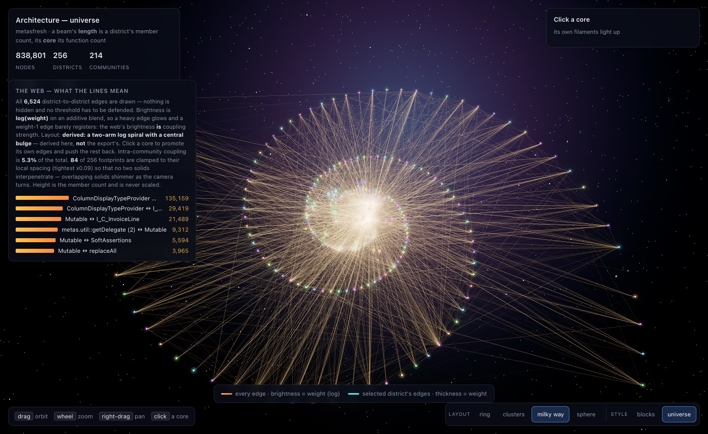

# Architecture City — design demos

A standalone preview of the **Architecture room** (change 4 of the dashboard-v2 sequence): the same real
data drawn **five layouts × two rendering styles**, with a coupling web and hover tooltips.

It is a design aid, not the room. It exists so the shape of the thing can be looked at and argued about
before it is built — and it has already earned that: these demos are what showed that the exported
coordinates are a ring rather than a floor plan.



## What it draws

Everything comes from one real `rgctl` dashboard bundle — metasfresh, **838,801 nodes / 2,847,044 edges**
collapsed into **256 districts** and **214 communities**:

| Channel | Source |
|---|---|
| position | the layout (below) |
| height | member count, log scale |
| footprint | function count, sqrt-compressed, clamped to local spacing |
| colour | community hue, assigned by golden angle over communities ranked by size |
| the web | **every one of the 6,524 district-to-district edges**; brightness is `log(weight)` on an additive blend |

Nothing is hidden: all edges are always drawn, so the web's brightness *is* coupling strength rather than a
choice about which edges deserve to be seen.

**Click** a solid to promote that district's own edges and push everything else back.
**Hover** a solid or an edge to name it — a node tooltip is blue-ish, an edge tooltip is amber (the
coupling colour) and names the two districts at its ends plus the weight and relation kind.

## Run it

Needs Node 18+ and any static file server.

```bash
npm install          # three.js
npm run vendor       # copies the three.js files the import maps expect into vendor/ (generated, not committed)
npm run serve        # http://127.0.0.1:8097
```

`data.json` is committed, so it runs without indexing anything. Python's `http.server` is fine but
single-threaded — it drops connections if you reload aggressively; use `npx serve` if that bothers you.

### Regenerating from your own corpus

```bash
cd <your-repo> && rgctl discover . --with-dashboard --with-cfg
MF_BUNDLE=<your-repo>/.rgctl/dashboard npm run data
```

`build-data.mjs` reads `metagraph.json` and `communities.json` from that bundle and writes `data.json`.
Two thresholds are tunable there: `COLOURED` (how many communities have their coupling pairs drawn) and
`COVER` (the share of coupling those pairs must cover).

## The five layouts

| Layout | What it is |
|---|---|
| **ring** | **The export's own coordinates.** One radius for every district — 256 districts 33 units apart on a circle, 360/256 apart in node-id order. It is honest and it is not a floor plan: every community's members are scattered right around it, so the web has no shape. The node id is not a size ranking either (id 0 is 66,487 and id 255 is the largest, 130,454), so the ring encodes nothing at all. |
| **clusters** | **Derived here.** Each community in a blob, the largest outermost. |
| **milky way** | **Derived here.** A two-arm log spiral with a central bulge. |
| **sphere** | **Derived here.** A globe; each community gets a cap sized by its member count, and solids stand on the surface normal. It has no plate and no grid, and the camera may pass **under** it — a globe has no "down", so the usual horizon clamp is lifted for this layout only. |
| **vortex** | **Derived here, and a formation rather than a map.** A 3D funnel: districts ordered biggest-community-first, wound down a cone with the widest mouth at the top. It encodes nothing; it exists so a 3D view has a volume to orbit, and the panel says so. |

## Two styles

| Style | What it is |
|---|---|
| **blocks** | lit solids on a plate — massing and gaps. three.js |
| **universe** | glowing beams and cores, bloom, a starfield. three.js + post-processing |

The style switcher carries the chosen layout across the page load.

A third style, `atlas`, was built and dropped as not needed. `STYLES.md` records what it was and keeps the
one durable lesson from it — read the motion of a reference, not four sampled stills.

## Honest notes

- **The derived layouts are ours, not the export's.** The app says so in the panel for each one. Only
  `ring` shows what the bundle actually contains.
- **Footprints are clamped where the layout is tight.** Two solids closer than their own width shimmer as
  the camera turns — the ring was 2.7× interpenetrated before this — so each footprint is clamped to
  `0.85 × nearest-neighbour distance`. The panel reports how many districts that binds and the tightest
  factor. **Height is never scaled**: it is the member count.
- **Community labels are the producer's own strings**, and **8 of the 256 district labels** (metagraph node
  labels, not community labels) embed the absolute path the corpus was indexed at — so the demo's output is
  machine-dependent. They are shown as-is rather than cleaned up, because rewriting them would hide a real
  defect.
- **Colour is derived here, not read from the bundle.** `communities[].color` looks usable but **collides**:
  214 communities carry only **160 distinct** hex values — 43 colours are reused, covering **97 communities**,
  one of them shared by four. The hue is assigned by golden angle over communities ranked by member count
  instead, which is unique by construction.
- **three.js measures 430 KiB gzipped as vendored here** (core 286.5 + module 130.8 + OrbitControls 8.3 + the
  post-processing closure). That is an **upper bound from an import-map copy of the whole library, untree-shaken**
  — the room proper bundles it and will measure less. The trade against the dashboard bundle's 136 KiB is real
  either way, and it is the room's open budget question, not this demo's.

## Files

| File | Role |
|---|---|
| `build-data.mjs` | reads a bundle → `data.json` (layouts, coupling aggregation, footprint clamps) |
| `layouts.js` | one place that knows what a layout is: `anchorOf`, `extentOf`, `webOffset` |
| `controls.js` | the control bar; layout and style, state carried in the URL |
| `app.js` | the `blocks` view (three.js) |
| `app-universe.js` | the `universe` view (three.js + bloom) |
| `index.html`, `universe.html`, `preview.css` | the two pages and their shared HUD |
| `STYLES.md` | what each style is, and the style that was dropped |
| `copy-vendor.mjs` | copies three.js into `vendor/` |
